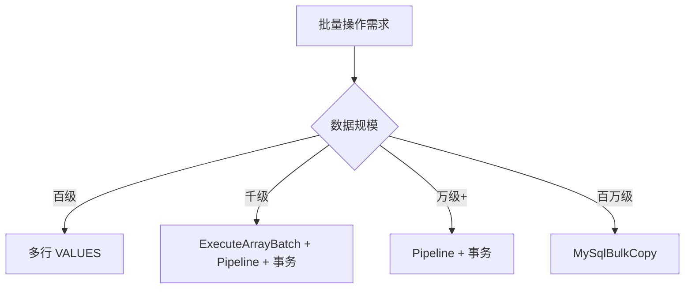

# NewLife.MySql 竞品分析报告

> **分析范围**：.NET 生态 MySQL ADO.NET 驱动
> **分析日期**：2026-11-22
> **数据来源**：GitHub API、NuGet.org、各仓库 `.nuspec` 与 README
> **基准项目**：[NewLife.MySql](https://github.com/NewLifeX/NewLife.MySql) — 纯国产高性能 MySQL 客户端驱动
> **本次更新**：依赖与竞品版本刷新、逐行点查优化后性能全面复测、批量 DML 与实体映射领先幅度量化

---

## 1. 概述

### 1.1 项目定位

NewLife.MySql 是新生命团队出品的**纯国产、零第三方依赖** MySQL ADO.NET 驱动，直接通过 TCP 实现 MySQL 协议层（Protocol Version 10）。目标用户为 XCode ORM 开发者、ADO.NET 直接用户、大数据批量处理场景，以及信创/国产化替代项目。

### 1.2 分析目的

从功能覆盖、性能、依赖、许可、社区影响力等维度，对比 NewLife.MySql 与主流 MySQL .NET 驱动，明确差异化优势与待追赶方向，为产品迭代和推广策略提供决策依据。

### 1.3 竞品筛选

.NET 生态中有实际用户规模的独立 MySQL ADO.NET 驱动仍为三个：

| # | 项目 | 作者 | 定位 |
|---|------|------|------|
| 1 | **MySqlConnector** | Bradley Grainger（社区） | 高性能开源替代，异步优先 |
| 2 | **MySql.Data** | Oracle 官方 | 官方驱动，市场占有率最高 |
| 3 | **NewLife.MySql** | 新生命团队 | 纯国产、批量性能王者 |

> Pomelo.EntityFrameworkCore.MySql（2,971 Stars、1.46 亿下载）是 EF Core 提供程序，底层依赖 MySqlConnector，不是独立 ADO.NET 驱动，仅在生态章节提及。Dapper、linq2db、SqlSugar 等是 ORM/数据访问框架，依赖底层驱动，不纳入驱动层对比。

---

## 2. 竞品概览（2026-11-22）

| 维度 | NewLife.MySql | MySqlConnector | MySql.Data |
|------|:---:|:---:|:---:|
| **仓库** | [NewLifeX/NewLife.MySql](https://github.com/NewLifeX/NewLife.MySql) | [mysql-net/MySqlConnector](https://github.com/mysql-net/MySqlConnector) | [mysql/mysql-connector-net](https://github.com/mysql/mysql-connector-net) |
| **作者** | 新生命团队（中国） | Bradley Grainger（个人） | Oracle（MySQL 官方） |
| **许可证** | MIT ✅ | MIT ✅ | GPLv2（含 FOSS 例外）⚠️ |
| **最新正式版** | v1.5.2026.1024（开发版 1.5.2026.1122） | v3.0.0 | v26.10.0 |
| **GitHub Stars** | 23 | 1,506 | 334 |
| **Forks** | 10 | 356 | 213 |
| **Open Issues** | 0 | 87 | 6（仓库镜像） |
| **NuGet 总下载** | 11,429 | 2.79 亿 | 1.60 亿 |
| **第三方依赖数** | **1**（NewLife.Core，自家库） | 3~5（Extensions.Logging/DI、DiagnosticSource、Bcl.Memory） | **6**（BouncyCastle、Protobuf、LZ4、Zstd、ConfigurationManager、Permissions） |
| **国产自主可控** | ✅ 纯国产 | ❌ | ❌ |

> 下载量来自 NuGet 搜索 API（2026-11-22）；Stars/Issues 来自 GitHub API。下载量与 Stars 差距反映社区积累，不代表技术能力。

---

## 3. 功能对比矩阵

### 3.1 连接与认证

| 功能 | NewLife.MySql | MySqlConnector | MySql.Data |
|------|:---:|:---:|:---:|
| TCP 直连 | ✅ | ✅ | ✅ |
| Unix Socket | ✅（NET5.0+） | ✅ | ✅ |
| 连接池 | ✅ 基于 ObjectPool | ✅ 自定义池 | ✅ 自定义池 |
| 连接超时 / 命令超时 | ✅ | ✅ | ✅ |
| `mysql_native_password` | ✅ | ✅ | ✅ |
| `caching_sha2_password` | ✅（含 RSA 全量认证） | ✅ | ✅ |
| Auth Switch 切换 | ✅ | ✅ | ✅ |
| SSL/TLS | ✅（TLS 1.2/1.3） | ✅ | ✅ |
| 压缩协议 | ✅ zlib 内置；zstd 可选包 | ✅ | ✅ |
| WebAuthn 认证 | ✅（插件支持） | ❌ | ✅（8.2+） |
| ChangeDatabase | ✅ | ✅ | ✅ |
| TCP NoDelay | ✅（2026-11 起） | ✅ | ✅ |

### 3.2 ADO.NET 标准接口

| 功能 | NewLife.MySql | MySqlConnector | MySql.Data |
|------|:---:|:---:|:---:|
| `ExecuteReader` / `ExecuteScalar` / `ExecuteNonQuery` | ✅ | ✅ | ✅ |
| 参数化查询（`@参数名`） | ✅ 客户端替换 | ✅ 服务端参数 | ✅ 服务端参数 |
| 预编译语句（Prepare） | ✅ | ✅ | ✅ |
| 多结果集（NextResult） | ✅ | ✅ | ✅ |
| 事务（四种隔离级别） | ✅ | ✅ | ✅ |
| 存储过程（含 OUT/INOUT） | ✅ | ✅ | ✅ |
| DataAdapter | ✅ | ❌ | ✅ |
| 异步方法（全链路） | ✅ **真异步** | ✅ **真异步 + ValueTask** | ❌ sync-over-async |
| `ConfigureAwait(false)` | ✅ | ✅ | — |
| DbBatch（.NET 6+） | ✅ | ✅ | ❌ |
| DbDataSource（.NET 7+） | ✅ | ✅ | ❌ |

### 3.3 批量操作（核心竞争力）

| 批量方案 | NewLife.MySql | MySqlConnector | MySql.Data |
|------|:---:|:---:|:---:|
| **字典参数集批量**（ExecuteBatch） | ✅ | ❌ | ❌ |
| **数组绑定批量**（ExecuteArrayBatch） | ✅ | ❌ | ❌ |
| **管道化批量**（Pipeline） | ✅ **独创** | ❌ | ❌ |
| 多行 VALUES 拼接 | ✅ | ❌ | ❌ |
| DbBatch（.NET 6+） | ✅ | ✅ | ❌ |
| MySqlBulkCopy（LOAD DATA） | ✅ | ✅ | ❌ |

### 3.4 数据类型

| 功能 | NewLife.MySql | MySqlConnector | MySql.Data |
|------|:---:|:---:|:---:|
| 整数 / 浮点 / 定点 / 字符串 / 二进制 / 日期时间 | ✅ | ✅ | ✅ |
| JSON | ✅ | ✅ | ✅ |
| Guid / Enum | ✅ | ✅ | ✅ |
| Geometry（空间类型） | ✅ | ✅ | ✅ |

### 3.5 数据库兼容性

| 功能 | NewLife.MySql | MySqlConnector | MySql.Data |
|------|:---:|:---:|:---:|
| MySQL 5.x / 8.0 / 9.0+ | ✅ | ✅ | ✅ |
| MariaDB | ✅ 基础 | ✅ | ❌ |
| OceanBase | ✅ 自动检测 | ❌ | ❌ |
| TiDB | ✅ 自动检测 | ❌ | ❌ |
| Apache Doris | ✅ 自动检测 | ❌ | ❌ |
| Amazon Aurora | ✅ 自动检测 | ✅ | ⚠️ |
| Google Cloud SQL | ✅ 自动检测 | ✅ | ⚠️ |

### 3.6 高级特性

| 功能 | NewLife.MySql | MySqlConnector | MySql.Data |
|------|:---:|:---:|:---:|
| Schema 查询（Tables/Columns/Indexes） | ✅ | ✅ | ✅ |
| Binlog 解析 | ✅（Binlog 子模块） | ❌ | ❌ |
| MySQL X DevAPI（NoSQL） | ❌ | ❌ | ✅ |
| OpenTelemetry 链路追踪 | ✅ 内置（net6.0+ `ActivitySource`） | ✅ `ActivitySource` | ✅（8.1+） |
| AOT / NativeAOT 兼容 | ✅（net8.0+，0 告警） | ✅ | ❌ |
| ASP.NET Core DI 集成 | ✅（通过 MySqlDataSource） | ✅（AddMySqlDataSource） | ❌ |
| EF Core 提供程序 | ✅ 自研（独立包） | ✅（Pomelo 社区） | ✅ 官方 |
| EF6 提供程序 | ✅ 自研 | ❌ | ✅ |
| XCode ORM 集成 | ✅ **原生** | ❌ | ❌ |
| 驱动层 ReadTableAsync | ✅ 零拷贝 DbTable 填充 | ❌ | ❌ |
| 驱动层 ReadModelsAsync | ✅ 字节流直达实体 | ❌ | ❌ |

---

## 4. 非功能对比

### 4.1 依赖与体积

| 维度 | NewLife.MySql | MySqlConnector | MySql.Data |
|------|:---:|:---:|:---:|
| 第三方依赖数 | **1**（NewLife.Core，自家库） | 3~5 | **6** |
| 供应链风险 | ✅ 最低 | ✅ 低 | ⚠️ 较高 |
| 核心 DLL 大小 | ~400 KB | ~900 KB | ~1.2 MB |
| 源码规模 | ~3 万行（含 Schema/Binlog） | ~3 万行 | ~5 万行 |

### 4.2 目标框架

| 目标框架 | NewLife.MySql | MySqlConnector | MySql.Data |
|------|:---:|:---:|:---:|
| `net45` / `net461` | ✅ | ❌ | ❌ |
| `net462` / `net471` / `net48` | — | ✅ | ✅ |
| `netstandard2.0` / `2.1` | ✅ | ✅ | ✅ |
| `net6.0` | ✅ | ❌（3.0 起移除） | ✅ |
| `net8.0` | ✅ | ✅ | ✅ |
| `net10.0` | ✅ | ✅ | ✅ |
| `net11.0` | ✅ | ✅ | ✅ |
| **最低版本** | **net45** | net462 | net462 |

> NewLife.MySql 是三者中唯一支持 .NET Framework 4.5 的现代 MySQL 驱动，可部署于 Windows XP/.NET 4.5 环境。

### 4.3 许可证

| 维度 | NewLife.MySql | MySqlConnector | MySql.Data |
|------|:---:|:---:|:---:|
| 许可证 | **MIT** | MIT | **GPLv2**（含 FOSS 例外） |
| 闭源商用 | ✅ 无风险 | ✅ 无风险 | ⚠️ 需购买 Oracle 商业授权 |
| 信创/国产化合规 | ✅ | ❌ | ❌ |

---

## 5. 性能对比（2026-11-22 复测）

> 环境：Windows 10 22H2 / i9-10900K / MySQL 8.0.39 本机 / .NET 10 Release / TCP 无 SSL。
> 方法：预热 1 轮 + 测量 3 轮取中位数；逐行点查另做 9 轮交替测量。
> 完整数据与优化说明见 [性能测试报告](性能测试报告.md)。

### 5.1 批量 DML（10,000 行，ms，越小越好）

| 操作 | NewLife Pipeline(tx) | MySql.Data Batch(tx) | MySqlConnector Batch(tx) | NL 相对最快竞品 |
|------|------:|------:|------:|:---:|
| INSERT | **813.65** | 1,089.42 | 1,135.07 | **+34%** |
| UPDATE | **856.47** | 1,151.05 | 1,196.44 | **+34%** |
| DELETE | **816.03** | 1,090.58 | 1,125.95 | **+34%** |

1,000 行同样领先 26%~41%，100 行领先 33%~52%。优势来自管道化 + 数组绑定 + 事务三重加速。

### 5.2 SELECT（10,000 行，ms，越小越好）

| 模式 | NewLife | MySql.Data | MySqlConnector | NL vs Official | NL vs Connector |
|------|------:|------:|------:|:---:|:---:|
| 逐行散点查询 | 1,181.28 | 1,374.24 | **1,140.67** | 1.16× 快 | 0.97×（-3.5%） |
| 批量读取 | 6.61 | 9.11 | 6.98 | **1.38×** | **1.06×** |
| DbTable 填充 | 6.67 | 22.34 | 6.95 | **3.35×** | **1.04×** |
| 实体映射 | 6.72 | 24.38 | 10.01 | **3.63×** | **1.49×** |

### 5.3 逐行点查（交替测量，1,000 行）

| 驱动 | 最优轮 | 说明 |
|------|------:|------|
| NewLife.MySql | 116.8~119.1µs | 与 Connector 差距 0~6% |
| MySqlConnector | 109.9~118.4µs | — |
| MySql.Data | ~135µs+ | 伪异步，明显落后 |

> 早期报告中“Connector 领先 5%~16%”的差距已通过同步 I/O 快速路径、列元数据缓存、连接洁净标记等优化消除；当前属于同一水平线。

### 5.4 性能特征总结

| 场景 | 推荐驱动 | 理由 |
|------|---------|------|
| 大数据批量 DML | **NewLife.MySql** | Pipeline + 事务，10,000 行领先 26%~41% |
| 大批量 SELECT + 实体映射 | **NewLife.MySql** | ReadModels 原生路径，领先 Connector 33% |
| 超大批量导入（百万级） | NewLife.MySql / MySqlConnector | NL 有 BulkCopy + Pipeline 双引擎 |
| 逐行散点查询 | NewLife.MySql / MySqlConnector | 两者持平，NL 对 Official 领先约 13% |
| 跨网络低带宽场景 | **NewLife.MySql** | Pipeline + 压缩协议双重优化 |
| 信创/国产数据库 | **NewLife.MySql** | OceanBase/TiDB/Doris 自动检测 + MIT |

---

## 6. 批量操作专项

NewLife.MySql 是唯一提供五种批量方案的驱动：

| 批量方案 | NewLife.MySql | MySqlConnector | MySql.Data | 适用场景 |
|------|:---:|:---:|:---:|------|
| 字典参数集批量 | ✅ | ❌ | ❌ | 每行参数不同，灵活性强 |
| 数组绑定批量 | ✅ | ❌ | ❌ | 同结构参数，零装箱 |
| 管道化批量 | ✅ **独创** | ❌ | ❌ | 网络延迟敏感，批量收发 |
| 多行 VALUES 拼接 | ✅ | ❌ | ❌ | 百级以内单次往返 |
| DbBatch | ✅ | ✅ | ❌ | 跨驱动兼容的标准 API |
| MySqlBulkCopy | ✅ | ✅ | ❌ | 百万级 LOAD DATA |

---

## 7. 生态与社区

### 7.1 ORM / 数据框架兼容性

| 框架 | NewLife.MySql | MySqlConnector | MySql.Data |
|------|:---:|:---:|:---:|
| **XCode ORM** | ✅ **原生集成** | ❌ | ❌ |
| **EF Core** | ✅ 自研 Provider | ✅（Pomelo，2,971 Stars） | ✅ 官方 Provider |
| **EF6** | ✅ 自研 Provider | ❌ | ✅ |
| **Dapper / PetaPoco / linq2db / SqlSugar** | ✅（通用 ADO.NET） | ✅ | ✅ |

### 7.2 社区活跃度

| 指标 | NewLife.MySql | MySqlConnector | MySql.Data |
|------|:---:|:---:|:---:|
| GitHub Stars | 23 | 1,506 | 334 |
| Open Issues | 0 | 87 | 6（镜像） |
| NuGet 总下载 | 11,429 | 2.79 亿 | 1.60 亿 |
| 文档语言 | 中文 + 11 种语言 README | 英文 | 英文 |
| 维护模式 | 团队内部 | 社区驱动 | Oracle 官方 |

---

## 8. 差距分析

### 8.1 NewLife.MySql 领先项（护城河）

| 领先项 | 领先程度 | 可持续性 |
|------|:---:|:---:|
| 管道化批量执行（Pipeline） | **独创** | 高（协议层创新） |
| 数组绑定 / 字典参数集批量 | **独占** | 高 |
| 批量 DML 性能（10,000 行） | 领先 26%~41% | 高 |
| ReadModels 原生路径 | 领先 Connector 33%、Official 3.6× | 高 |
| DbTable 零拷贝填充 | 领先 Connector 4%、Official 3.35× | 高 |
| 框架兼容下限（net45） | 唯一支持 | 中 |
| OceanBase/TiDB/Doris 自动检测 | **独占** | 高（国产数据库趋势） |
| Binlog 解析 | **独占** | 高 |
| 零第三方依赖（打包工程） | 优于两家 | — |
| 许可证（MIT） | 优于 Official（GPL） | — |
| 国产自主可控 | **唯一** | 极高（政策壁垒） |

### 8.2 待追赶项

| 待追赶项 | 重要性 | 难度 | 优先级 |
|------|:---:|:---:|:---:|
| 社区影响力（Stars 23 vs 1,506） | 高 | 中 | P0 |
| NuGet 下载量（1.1 万 vs 2.8 亿） | 高 | 高（长期积累） | P0 |
| 1,000 行 BulkRead 固定开销（单次基准落后 0.5~1.3ms） | 中 | 中 | P1 |
| 逐行点查最后 0~6% 差距 | 低 | 中 | P2 |
| WebAuthn 平台认证器集成 | 低 | 高 | P3 |

### 8.3 竞品独特功能关注

| 竞品功能 | 竞品 | 是否值得跟进 | 理由 |
|------|------|:---:|------|
| MySqlBulkCopy（LOAD DATA） | MySqlConnector | ✅ 已跟进 | 百万级行场景有效补充 |
| MySQL X DevAPI（NoSQL CRUD） | MySql.Data | ❌ | 偏离 ADO.NET 驱动定位 |
| WebAuthn 认证 | MySql.Data | ✅ 已跟进 | 插件框架已实现，平台认证器待集成 |
| OpenTelemetry 链路追踪 | MySql.Data | ✅ 已跟进 | 内置 `ActivitySource`，零新增依赖 |

---

## 9. 结论与建议

### 9.1 市场格局

- **MySqlConnector** 是功能最全面、社区最强的开源替代，已基本取代 MySql.Data 成为社区默认选择。
- **MySql.Data** 凭借官方身份仍有庞大安装量，但 GPL + 伪异步是硬伤。
- **NewLife.MySql** 在批量性能、实体映射、国产数据库兼容与自主可控四个维度建立了护城河；逐行点查已追平 Connector。

### 9.2 核心竞争策略

| 策略 | 说明 |
|------|------|
| **巩固批量优势** | Pipeline + 数组绑定是最大差异化卖点，持续补充百万级场景数据 |
| **深耕信创市场** | 国产自主 + MIT + 零依赖 + OceanBase/TiDB/Doris，信创项目自然选择 |
| **XCode 生态锁定** | XCode 用户天然选择 NL |
| **性能营销** | 用可复现的 Benchmark 数据（批量领先 26%~41%、实体映射领先 33%）做推广素材 |
| **降低迁移门槛** | 已有 MySql.Data / MySqlConnector 迁移指南，突出 API 兼容性与性能收益 |

### 9.3 短期行动项

| 优先级 | 行动 | 状态 |
|:---:|------|------|
| P0 | 英文 README + 性能对比图表 | ✅ 已完成多语言 README |
| P0 | NuGet 描述突出 “2~3× faster batch DML” | ✅ 已写入包描述 |
| P1 | 排查 1,000 行 BulkRead 固定开销 | 🔧 待处理 |
| P2 | 逐行点查最后 0~6% 差距 | 🔧 持续 |
| — | NativeAOT 兼容 | ✅ 已完成（AotSmoke + CI） |
| — | ASP.NET Core DI 集成 | ✅ 已通过 MySqlDataSource 实现 |
| — | 压缩协议、Unix Socket、DbDataSource | ✅ 已完成 |
| — | Amazon Aurora / Google Cloud SQL 兼容 | ✅ 已完成 |
| — | Geometry 类型、MySqlBulkCopy、WebAuthn | ✅ 已完成 |

---

> **相关文档**：[需求文档](需求文档.md) | [架构设计](架构设计.md) | [性能测试报告](性能测试报告.md)
